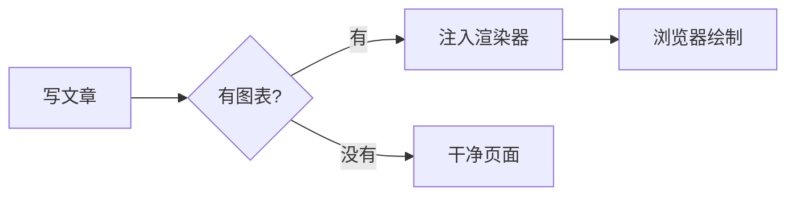

# 数学公式：xfm-plugin-math

```bash
npm i -D xfm-plugin-math
```

装完即用，无需配置。三种写法都支持：

- 行内公式：`$a^2 + b^2 = c^2$`
- 块级公式：`$$\int_a^b f(x)\,dx$$`
- LaTeX 原生定界符：`\(行内\)` 与 `\[…\]`

## 构建期渲染，不是前端渲染

公式在 `xfm build` 时就换成 KaTeX HTML——页面里是**纯静态 HTML + CSS**，没有客户端 JS、没有 MathJax 那样的渲染延迟。KaTeX 样式表和 woff2 字体被复制到 `assets/katex/` 本地托管，不依赖 CDN，离线可用。

## 下划线不再变斜体

写 `$a_1$` 最怕下划线被 Markdown 吃成斜体。插件在 Markdown 处理**之前**把公式换成私有区占位符，Markdown 引擎根本看不见 `$...$` 里的 `_` 和 `*`；渲染完再换回公式 HTML。

## 安全边界

- 代码块（缩进、围栏、行内）里的 `$` 原样保留，不会被误判成公式
- `\$` 转义写美元金额不会被渲染成公式

# 图表：xfm-plugin-mermaid

```bash
npm i -D xfm-plugin-mermaid
```

把 mermaid 围栏代码块直接变成图表：

````markdown

````

## 只在需要的页面注入

构建时扫描页面内容：**含 mermaid 块的页面**才注入渲染器脚本，其他页面保持干净。渲染器默认从 `assets/mermaid/` 本地加载，也可以 `mermaid.mode: 'cdn'` 走 CDN 减小体积。

## 逐页关闭

某页不想渲染图表（比如教程里要展示 mermaid 源码本身）：

```yaml
---
mermaid: false
---
```

::: tip
两个插件都自带 README、测试脚本和示例站 demo，属于"装完零配置"的体验型插件。技术博客写算法推导用 math，架构说明用 mermaid，配合食用效果最佳。
:::

---

—— [xfmpress 使用教程](/series/xfmpress使用教程/) 系列全部 13 章到此完结，祝你建站愉快。
