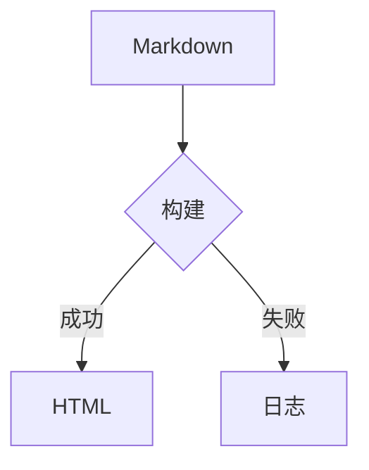

画架构图、时序图、流程图，最省事的方式是直接在 Markdown 里写 mermaid 代码。xfm-plugin-mermaid 是 xfmpress 官方图表插件，与 0.4.15 同期推出的[数学公式插件](/2026/11/21/xfmpress-plugin-math/)互为补充：公式走构建期渲染，图表则交由浏览器渲染成 SVG。你只管写一个 ` ```mermaid ` 围栏代码块，浏览器把它画出来。

## 它解决什么

不装插件时，mermaid 代码块只是一段普通代码展示；逐页手写 `<script>` 引入 mermaid 又会在不需要图表的页面白载一个 5 MB 的包。本插件在构建时扫描每页 HTML，**只给真正含图表的页面**注入渲染脚本和一小段样式，其余页面保持干净。

## 安装与配置

```bash
npm i -D xfm-plugin-mermaid
```

装完即生效，或在 [配置文件](/2026/11/21/xfmpress-config/) 里显式声明：

```js
// xfm.config.mjs
export default {
  plugins: ['mermaid'],
  mermaid: {
    mode: 'local',          // 'local' 复制进产物 | 'cdn' | 'none' 自己引
    path: 'assets/mermaid', // mode: 'local' 时的产物目录
    theme: 'default',       // default | neutral | dark | forest | base
    securityLevel: 'loose', // 允许点击交互与 HTML 标签；不信任内容时用 'strict'
    option: {},             // 其余选项原样并入 mermaid.initialize()
  },
};
```

所有 mermaid 图类型都支持：流程图、时序图、类图、状态图、ER 图、甘特图、饼图、git graph、脑图、时间线、象限图、桑基图等等。

## 产物与写法

````markdown

````

构建后代码块变成 `<pre class="mermaid">…</pre>`，页面 `</body>` 前注入 `<script src>` 和一段调用 `mermaid.run()` 的引导脚本，路径自动套用站点 `base`。默认 `mode: 'local'` 时构建会把 `mermaid.min.js` 复制到 `assets/mermaid/`——本地托管，离线可用，无第三方请求。

## 注意事项

**为什么选浏览器端渲染**：mermaid 依赖 DOM 与真实文本测量，构建期渲染得挂 jsdom 或无头浏览器，与 xfmpress「零依赖、秒级构建」的承诺相悖。客户端渲染的代价只是含图页面多一次脚本执行，换来构建零依赖，而且图会随页面字体与主题自适应。

**体积与缓存**：`mermaid.min.js` 未压缩约 5 MB（gzip 后约 1.2 MB），大多数静态托管平台自动压缩，浏览器在访问过第一个含图页面后即缓存。介意体积可改 `mode: 'cdn'` 走 jsDelivr，产物里不落任何文件；不介意加载来源则维持 `local`，[部署](/2026/11/21/xfmpress-deploy/) 后完全自持。

**逐页关闭**：某页要展示 mermaid 源码本身（比如本插件的教学页），在该页 front-matter 写 `mermaid: false`，代码块保持普通代码清单原样。页内已手写 mermaid 脚本时插件不会重复注入。插件生态总览见[官方插件](/2026/11/21/xfmpress-plugins/)。
