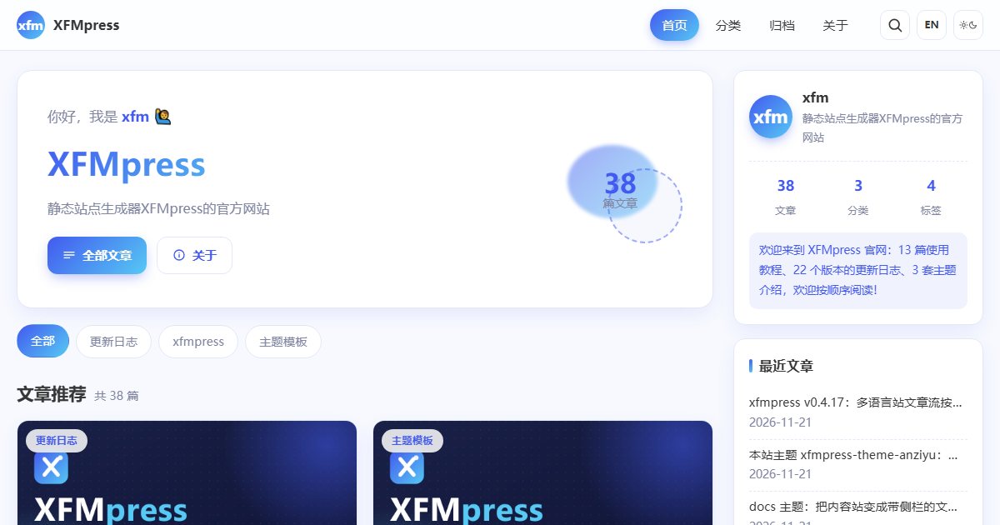

你现在看到的这个站点，用的不是官方 `default`，而是仓库 `themes/` 下的站点私有主题 `xfmpress-theme-anziyu`。起因很简单：从 Hexo 迁过来时最舍不得的是 [hexo-theme-anzhiyu](https://github.com/anzhiyu-c/hexo-theme-anzhiyu) 那套观感——固定玻璃导航、顶部横幅、带封面的卡片流、右侧挂件——于是用 xfmpress 的模板语法重写了一遍，顺手把不需要的部分全砍掉。



上图就是本站首页的真实截图（1200×630）：左侧是文章流，右侧是三组挂件（站点简介 + 语言统计、分类、最近文章）。封面缺失时卡片落回统一的兜底图，所以列表永远是整齐的。

## 七个布局，六个片段

```
themes/xfmpress-theme-anziyu/
├── layouts/
│   ├── base.html        # 骨架：进度条、导航、main、页脚、回到顶部、图片遮罩
│   ├── index.html       # 首页：Hero 横幅 + 分类快捷条 + 卡片流 + 侧栏
│   ├── post.html        # 文章页：封面横幅、正文卡片、目录、评论、相关
│   ├── page.html        # 独立页（关于）
│   ├── taxonomy.html    # 标签 / 分类 / 系列聚合
│   ├── categories.html  # 分类索引
│   └── archives.html    # 归档
├── partials/            # navbar / footer / post-card / pager / sidebar / toc
└── assets/              # style.css（约 31KB）/ main.js / search.js / 封面与图标
```

没有 `collection.html`——本站不用自定义集合，需要时再补。

## 视觉上的四个标志

**玻璃质感导航**：`backdrop-filter: blur()` + 半透明背景，滚动时降低透明度并加阴影；窄屏收成抽屉式菜单。

**Hero 横幅**：左侧一句「你好，我是」，下面是站名与描述，配两个按钮（全部文章、关于）；右侧是装饰图形加一个 `site.langCounts` 的文章总数——这个数字在 `/en/` 会自己变成英文文章数。

**分类快捷条**：横幅下面一排圆角 chip，遍历 `site.categoriesZh` / `site.categoriesEn`，点一下直达分类页。

**封面卡片流**：每张卡片顶部是 16:9 封面，没写 `cover` 的文章自动落回 `assets/cover-default.png`（1200×630，与 OG 图同款），所以列表永远不会出现空白块。卡片正文用 `post.desc`，摘要长度由引擎控制。

## 文章页：封面当背景

文章页的头部不是白底标题，而是把封面铺满、压一层渐变遮罩，标题浮在遮罩上，顺便带出面包屑（分类 + 发布日期）、阅读时长和话题标签。正文在白色卡片里，右侧是 `toc.html`——`main.js` 用 `IntersectionObserver` 跟随滚动高亮当前小节。

正文下面三块依次是：Waline 评论区（`#waline` 挂载点，只在文章页出现）、相关推荐（来自 `related` 插件）、前后篇文章。

## 侧栏与页脚

侧栏四组挂件：文章统计（总数 + 语言分布）、分类（按语言取）、标签云、最近文章。所有文案都用 `page.lang === 'en'` 三元切换，所以英文页不会混进中文字样。

页脚一行版权、一行「由 xfmpress 0.4.17 强力驱动」——版本号不是手写的，`plugins/engine-version.js` 每次构建读 `node_modules/xfmpress/package.json`，升级依赖后页脚自动跟上。

## 交互都写在 3.8KB 里

`main.js` 只做六件事：顶部阅读进度条、回到顶部按钮、移动端菜单抽屉、目录滚动高亮、代码块复制按钮、图片点击放大（`#img-mask` 遮罩）。没有任何框架，`defer` 加载，首屏不阻塞。

## 想改的话从哪里下手

- **换主色**：`style.css` 顶部的 `--ac`（安知鱼蓝 `#425aef`）与 `--grad`，深浅色各一组，改两行全站生效；
- **加挂件**：在 `partials/sidebar.html` 里加一段 `section.widget`，样式复用现有类；
- **改卡片**：`partials/post-card.html` 是唯一渲染列表项的地方，首页、分类、标签、归档共用；
- **换封面兜底图**：直接替换 `assets/cover-default.png`，尺寸保持 1200×630 即可。

有一个坑值得记下来：`` 的片段拿不到父模板 `for` 循环里的变量，也拿不到 `set`。所以 `post-card.html` 里不能指望外面传 `post` 进来，得自己在片段内部重新取列表（`page.data.pagination.posts` 或 `posts`），两套页面都兼容。

## 它的定位

这不是一个发布到 npm 的主题，而是**跟着站点一起长**的私有皮肤：想加什么直接改，不用考虑向后兼容；也不想做通用化——通用化是 `default` 和 `docs` 的活。如果你想抄这套观感，把目录拷进自己项目的 `themes/` 再改配色就行，模板语法和官方主题完全一致。
