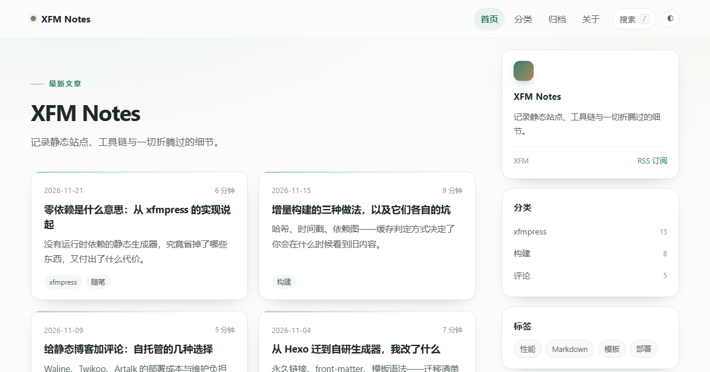

`default` 是 xfmpress 仓库里两套官方主题中的博客主题，也是 `npm i xfmpress` 之后默认能用的那一套：不装任何插件、不写一行 CSS，`theme: 'default'` 就能得到一个结构完整的个人博客。它不追求视觉冲击，走的是低饱和青玉色 + 大留白的阅读路线。



上图是这套主题的实际渲染效果（1200×630）：顶部是水平导航，左侧 Hero 写站名与描述，中间两列文章卡片，右侧依次是站点简介、分类、标签与归档入口。配色、圆角与留白都是主题自带的，没有额外的自定义样式。

## 目录结构与布局分工

```
themes/default/
├── layouts/
│   ├── base.html        # 骨架：头部导航、main、页脚、深浅色脚本
│   ├── index.html       # 首页：Hero + 卡片流 + 侧栏
│   ├── post.html        # 文章页：头部 meta、右侧目录、前后篇、相关推荐
│   ├── page.html        # 独立页（关于、友链）
│   ├── taxonomy.html    # /tags/x/、/categories/x/、/series/x/
│   ├── categories.html  # /categories/ 分类索引
│   ├── archives.html    # /archives/ 按年归档
│   └── collection.html  # 自定义集合列表（projects 之类）
├── partials/            # post-list / pager / toc / lang-switcher
└── assets/              # style.css / search.js / toc.js / ux.js
```

布局齐全的好处是：只要配置里开着 `indexes`，分类索引页与归档页会自动生成，不用自己补模板；`collections` 一开，`collection.html` 立刻能接住自定义集合。

## 首页的三块结构

首页由三段拼成，逻辑写在 `index.html` 里：

- **Hero**：`site.title` + `site.description`，一行 eyebrow 写「最新文章」；
- **卡片流**：`post-list.html` 统一渲染，卡片带日期、标题、`post.desc`（没写 `description` 时用正文自动截断的摘要）和标签；
- **右侧栏**：关于卡片（作者 + RSS 入口）、分类（最多 6 个）、标签云（最多 12 个）、归档入口。计数用 `postsTotal`，所以多语言站的 `/en/` 显示的是英文文章数，不是全站数。

分页由 `pagination.perPage` 驱动，`/page/2/` 是真实静态页，不是前端切片。

## 文章页的阅读细节

文章页左手正文、右手目录。`headings` 非空时才渲染目录，`toc.js` 负责跟随滚动高亮当前小节——长文里这个细节比想象中重要。正文下面是 `page.data.prev` / `page.data.next` 的前后篇，再下面是 `related` 插件算好的相关文章（标签 3 分、分类 2 分、系列 3 分加权），没装插件就整块不出现，不会报错。

## 交互与可配置项

`ux.js` 约 3KB，干了四件事：代码块加复制按钮、图片点击放大、顶部阅读进度、外链自动新窗口——页面没有对应元素时静默跳过。装了 `search` 插件后，导航里会多出一个搜索按钮，`Ctrl/⌘ + K` 打开纯前端筛选面板，索引来自 `search.json`。

浅色/深色是 CSS 变量切换，选择存在 `localStorage` 的 `xfm-theme` 键里，首次访问跟随系统偏好。

要改观感，最省事的路径是 `assets/style.css` 顶部那组变量：

```css
:root {
  --accent: #2f7d6a;   /* 主色：青玉 */
  --warm: #c68b62;     /* 点缀色 */
  --radius: 16px;      /* 卡片圆角 */
  --wrap: 760px;       /* 正文宽度 */
}
```

## 适合谁，不适合谁

适合：个人博客、折腾记录、想十分钟上线一个能看的站点。

不适合：需要侧栏文档导航的产品手册（用 `docs` 主题）、想要强视觉风格的站点（得自己写一套，比如本站的 `xfmpress-theme-anziyu`）。它不是「万能模板」，而是把博客最常见的几块拼好了给你，改起来毫无负担——四个布局文件加起来不到 200 行。
