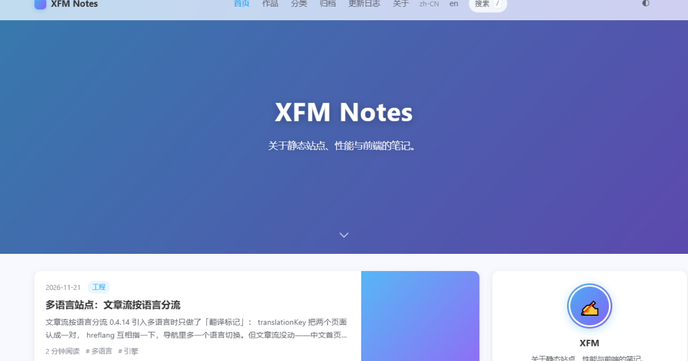

官方仓库今天多了一套主题：`themes/butterfly`。它是照着 [hexo-theme-butterfly](https://github.com/jerryc127/hexo-theme-butterfly) 的视觉风格重写的——如果你从 Hexo 迁过来，见到那套蓝紫渐变、毛玻璃导航、封面在右的横向卡片，应该会有一秒的熟悉感。

和仓库里另外两套一样，它零依赖、零构建：模板只用 xfm 内置的 ` /  / `，样式和脚本全是手写的 CSS 与原生 JS，没有 Sass 编译，也没有打包步骤。



上面是它跑在演示站上的实际效果（截取 1200×630）：顶部固定导航，中间是渐变横幅和站名，下面是横向文章卡片，右侧是作者卡。整套观感只靠一个 29KB 的 `style.css` 和 7KB 的 `main.js`。

## 怎么启用

主题用仓库里的相对路径指定即可：

```js
// xfm.config.mjs
export default {
  theme: 'themes/butterfly',
};
```

一个现实问题：`npm i xfmpress` 装下来的包里目前只有 `default` 和 `docs` 两套主题，butterfly 是在仓库里先行落地的。所以现在要用它，把仓库的 `themes/butterfly` 整个目录拷到你站点的 `themes/` 下（或直接克隆仓库跑 `examples/blog`），配置里写 `themes/butterfly`；等你站点根目录有同名目录，主题解析会优先用你站点里的那份。

主题解析的顺序是「站点内路径 → npm 包内置 → 简写补齐」，所以 `theme: 'butterfly'` 这种简写只对包里自带的那两套生效，拷到站点里之后写全路径最稳妥。

## 目录：8 个布局，5 个片段

```
themes/butterfly/
├── layouts/
│   ├── base.html        # 骨架：进度条、固定导航、横幅插槽、页脚、回到顶部、深浅色脚本
│   ├── index.html       # 首页：横幅 + 卡片流 + 侧栏
│   ├── post.html        # 文章页：封面横幅、正文卡、版权框、上下篇、相关推荐、目录
│   ├── page.html        # 独立页
│   ├── archives.html    # 时间线归档（按年分组）
│   ├── categories.html  # 分类索引
│   ├── taxonomy.html    # 单个分类 / 标签的文章列表
│   └── collection.html  # 自定义集合列表
├── partials/            # post-list / pager / sidebar / toc / lang-switcher
└── assets/              # style.css（29KB）/ main.js（7.4KB）/ search.js
```

横幅不是每个布局各写一遍，而是 `base.html` 里留了一个 ``：首页与文章页各自覆盖它，独立页和归档页不覆盖，于是那几页直接没有横幅，也不会留下空白占位。

## 四个视觉标志

**毛玻璃固定导航**：`backdrop-filter: blur(14px)` + 半透明背景，滚动超过 10px 加阴影；窄屏（≤860px）收成抽屉菜单，三条横线做变形动画。

**渐变横幅**：不配 `site.banner` 时是一块 132 度的蓝紫渐变（`#49b1f5 → #8661f5`），配了就换成图片加 38% 深色遮罩——遮罩这一步不能省，否则浅色图片上的白字会糊成一片。首页横幅高度是 `min(62vh, 560px)`，文章页是 `min(46vh, 420px)`，手机端再压一档。

**封面在右的横向卡片**：卡片左边是日期、分类胶囊、标题、两行截断的摘要和标签，右边固定 220px 的一张封面，悬停时封面 `scale(1.05)`、卡片上浮 3px。文章没写 `cover` 就落回渐变兜底块，列表不会出现豁口。窄于 560px 时卡片换成竖排，封面跑到上方。

**右侧栏**：作者卡（头像 + 一句话简介 + 文章/分类/标签三个计数 + RSS 按钮）、前 6 个分类带计数、前 16 个标签的胶囊云、最新 5 篇、归档入口。整栏 `position: sticky`，滚动时跟着走；窄于 1024px 时收成单列，粘性取消。

## 文章页的细节

文章页的结构比首页更满：封面横幅（标题、日期、分类、标签、阅读时长都压在遮罩上）→ 白色正文卡 → 版权框 → 上下篇 → 相关推荐 → 右栏目录。

几个值得说的取舍：

- **目录只在有标题时才出现**。`headings` 为空时整个右栏不渲染，正文卡自动回到 800px 的居中宽度；有目录时容器放宽到 1080px 两栏，窄于 900px 时右栏直接隐藏，不做抽屉。
- **版权框只在配了 `site.author` 时出现**，内容是作者、本文链接、一句「转载请注明出处」。不想显示就别写 `site.author`。
- **相关推荐读 `page.data.related`**，也就是 `related` 插件算出来的那份；没装插件这块不出现，不会报错。
- **代码块带语言标签和复制按钮**，按钮默认透明度 0，鼠标悬停整块代码才浮出来，不干扰阅读。

## 可选字段

全在 `site` 下，都不配也能跑：

| 字段 | 作用 | 缺省行为 |
| --- | --- | --- |
| `site.banner` | 首页横幅背景图 | 走蓝紫渐变 |
| `site.subtitle` | 横幅副标题 | 回退 `site.description` |
| `site.avatar` | 作者卡头像 | 显示 ✍ 占位 |
| `site.author` | 作者卡名字、文章版权框 | 名字用 `site.title`，版权框整块不渲染 |
| `site.copyright` | 页脚版权行 | `© 站点标题` |

文章封面走 front-matter：

```yaml
---
title: 我的第一篇文章
date: 2026-11-22
cover: /img/hello.jpg   # 建议根绝对路径或外链；Page Bundle 里可写 ./cover.png
---
```

`cover` 只影响这套主题的展示，RSS、sitemap 和其它主题都不看它。

## 交互与配色

`main.js` 七个模块：导航抽屉与滚动阴影、回到顶部、阅读进度、目录高亮、代码复制、图片点击放大、外链自动新窗口。所有滚动相关的计算统一走 `requestAnimationFrame`，一帧最多算一次；页面上没有对应元素时整段静默跳过，所以你把它塞进任何页面都不会报错。

深浅色是 `data-theme` 切换的手写变量，键名 `xfm-theme-butterfly`，首次访问跟随系统 `prefers-color-scheme`。要换配色改 `style.css` 顶部这几行就够：

```css
:root {
  --accent: #49b1f5;    /* 主色：天蓝 */
  --accent-2: #8661f5;  /* 副色：紫 */
  --grad: linear-gradient(132deg, #49b1f5 0%, #8661f5 100%);
  --radius: 12px;       /* 卡片圆角 */
  --nav-h: 60px;        /* 导航高度 */
}
```

装了 `search` 插件后，导航右侧会自动多出一个搜索按钮（插件会注入 `site.search`），`Ctrl/⌘ + K` 打开纯前端筛选面板；深浅色切换按钮在它右边，两者都是无依赖的原生实现。

## 和三套主题怎么选

| 主题 | 观感 | 适合 |
| --- | --- | --- |
| `default` | 低饱和青玉、大留白 | 只想安静写字 |
| `docs` | 左侧栏文档树 | 产品手册、知识库 |
| `butterfly` | 蓝紫渐变、卡片瀑布、重装饰 | 个人博客、想第一眼就有辨识度 |
| `xfmpress-theme-anziyu` | 玻璃导航 + 封面卡片流（本站私有） | 想要更花哨的博客外观 |

它和 `default` 用的是同一套模板语法、同一份内容格式，切换主题不用改任何 Markdown——这也是把主题做成目录而不是内核的一部分的好处：想换皮，改一行 `theme` 再重新 `xfm build` 就行。
