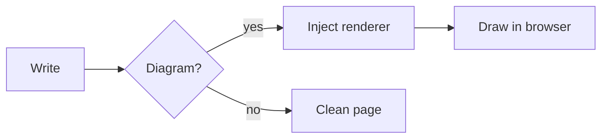

# Math: xfm-plugin-math

```bash
npm i -D xfm-plugin-math
```

Zero config after install. Three syntaxes all work:

- Inline: `$a^2 + b^2 = c^2$`
- Display: `$$\int_a^b f(x)\,dx$$`
- Native LaTeX delimiters: `\(inline\)` and `\[…\]`

## Build-time rendering, not front-end rendering

Formulas become KaTeX HTML during `xfm build` — pages ship **pure static HTML + CSS**, no client-side JS, none of MathJax's render delay. The KaTeX stylesheet and woff2 fonts are copied to `assets/katex/` and served locally — no CDN dependency, works offline.

## No more italic underscores

`$a_1$` used to fear the Markdown engine eating underscores as emphasis. The plugin swaps formulas for private-use placeholders **before** Markdown runs, so `_` and `*` inside `$...$` are invisible to it; they're swapped back after rendering.

## Safe boundaries

- `$` inside code blocks (indented, fenced, inline) stays literal
- `\$` escapes dollar amounts from becoming formulas

# Diagrams: xfm-plugin-mermaid

```bash
npm i -D xfm-plugin-mermaid
```

Turns mermaid fenced blocks into diagrams:

````markdown

````

## Renderer only where needed

The build scans page content: pages **containing mermaid blocks** get the renderer script; everything else stays clean. The renderer loads from `assets/mermaid/` locally by default, or set `mermaid.mode: 'cdn'` to slim the bundle.

## Per-page switch

To show raw mermaid source on a page (say, a tutorial about mermaid):

```yaml
---
mermaid: false
---
```

::: tip
Both plugins ship READMEs, test scripts and example-site demos — true "install and forget" experience plugins. Use math for algorithm derivations, mermaid for architecture notes.
:::

---

That wraps all 13 chapters of the [xfmpress guide](/series/xfmpress%20guide/) series — happy site building.
