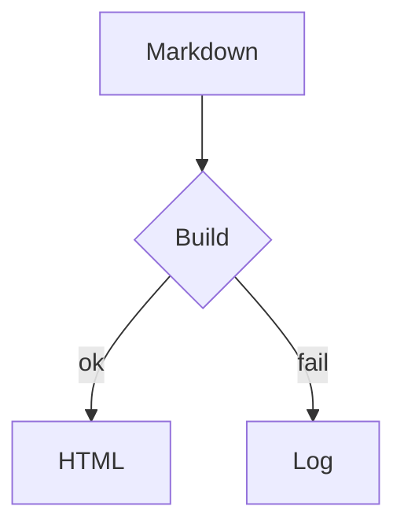

For architecture, sequence, and flow diagrams, nothing beats writing mermaid directly in Markdown. `xfm-plugin-mermaid` is the official xfmpress diagram plugin, complementing the [math plugin](/en/2026/11/21/xfmpress-plugin-math/) released alongside it: formulas render at build time, while diagrams are rendered in the browser. Write a ` ```mermaid ` fenced code block and the browser draws it.

## What it solves

Without the plugin, a mermaid block is just another code listing; hand-writing a `<script>` tag on every page would load a 5 MB bundle even where no diagram exists. The plugin scans each page's HTML at build time and injects the renderer **only on pages that actually contain a diagram**, leaving every other page untouched.

## Install and configure

```bash
npm i -D xfm-plugin-mermaid
```

That is all, or declare it explicitly in your [config file](/en/2026/11/21/xfmpress-config/):

```js
// xfm.config.mjs
export default {
  plugins: ['mermaid'],
  mermaid: {
    mode: 'local',          // 'local' copy into output | 'cdn' | 'none' (bring your own)
    path: 'assets/mermaid', // output directory when mode: 'local'
    theme: 'default',       // default | neutral | dark | forest | base
    securityLevel: 'loose', // allows click handlers and HTML labels; use 'strict' for untrusted content
    option: {},             // merged into mermaid.initialize()
  },
};
```

Every Mermaid diagram type works — flowchart, sequence, class, state, ER, gantt, pie, git graph, mindmap, timeline, quadrant, sankey, and the rest.

## Output and usage

````markdown

````

The build turns the block into `<pre class="mermaid">…</pre>`, then injects a `<script src>` plus a tiny bootstrap calling `mermaid.run()` before `</body>`, with the site `base` applied. With the default `mode: 'local'`, the build copies `mermaid.min.js` into `assets/mermaid/` — self-hosted, works offline, no third-party requests.

## Details worth knowing

**Why client-side rendering**: Mermaid needs a DOM and real text measurements; rendering at build time would mean pulling in jsdom or a headless browser, which contradicts xfmpress's zero-dependency, sub-second builds. The cost is one script execution on diagram pages; the benefit is instant builds and diagrams that reflow with the page font and theme.

**Size and caching**: `mermaid.min.js` is roughly 5 MB uncompressed, about 1.2 MB gzipped. Most static hosts compress it automatically, and the browser caches it after the first diagram page. If the size bothers you, switch to `mode: 'cdn'` to load from jsDelivr and write nothing into your output; otherwise keep `local` for fully self-contained [deployment](/en/2026/11/21/xfmpress-deploy/).

**Per-page opt-out**: on a page that shows mermaid source itself (like a tutorial for this plugin), set `mermaid: false` in the front-matter and the block stays a plain code listing. The plugin also never double-injects when the page already has its own mermaid script. For the rest of the ecosystem, see the [plugin overview](/en/2026/11/21/xfmpress-plugins/).
