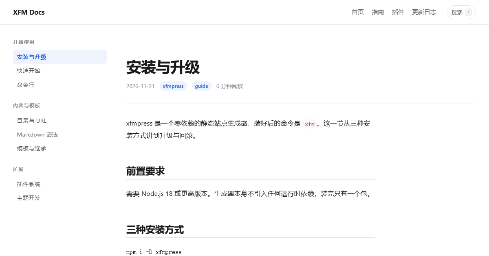

The other official theme, `docs`, solves a different problem: a blog wants a reverse-chronological stream, documentation wants a knowledge tree. The same content rendered with `default` reads like a blog; with `docs` it reads like a manual — a sidebar that never leaves, a wider measure, and browsing that feels like *looking things up* rather than *scrolling through*.



The screenshot above is the real render at 1200×630: site name and global links on top, a sidebar grouping entries under "Getting started / Content & templates / Extending" with the current page highlighted, and the article with title, meta, prose and a code block. No cards, no covers — everything is there to be scanned.

## The three-column shell

`base.html` cuts the page into three parts:

- **Top nav** — the `nav` config, the language switcher, the search button, inside `wrap-wide` (wider than the blog theme);
- **Left sidebar `docs-nav`** — walks `site.navGroups`, one heading per group, items sorted by `weight` ascending;
- **Main `docs-main`** — body plus the right-hand `toc.html`, with the footer tucked inside the main column instead of spanning the page.

The palette is a calm blue (`--accent: #2563eb`), sans-serif body, grey code blocks — closer to a hosted docs site than to a magazine.

## The sidebar grows itself

This is both the most convenient and the most easily missed part: sidebar entries come from front-matter, not from a menu file.

```yaml
---
title: Installation & Upgrades
group: Guide
weight: 1
---
```

During collection the engine groups pages that carry `group` (or the equivalent `section`), sorts them, and exposes `site.navGroups`. So:

- to appear in the sidebar, set `group`;
- to control reading order, set `weight` (lower first);
- to hide a page from the sidebar, set `nav: false`;
- a page without `group` does not vanish — it just sits in the "contents" list on the home page instead.

`weight` is compared inside a group only; the order of groups is the order in which they first appear. With several groups, leave gaps (10, 20, 30) so inserting one later does not mean renumbering everything.

## The home page is a table of contents

`index.html` here does not render a card stream. It treats the body of `content/index.md` as a preface and then lists every `navGroups` entry with the name of its group. For documentation that beats "latest posts": the first thing a visitor sees is the structure, not a timeline.

## Four differences from `default`

| | default | docs |
| --- | --- | --- |
| Navigation | top nav only | top nav + grouped sidebar |
| Home | hero + card grid + sidebar | preface + contents list |
| Archive / category index | `archives.html`, `categories.html` | only `taxonomy.html`, `collection.html` |
| Light / dark | toggle button, remembered in localStorage | dark CSS variables only, no switch |

The last row deserves attention: the dark variables are all there in `style.css`, but no button is emitted and nothing reads the system preference. Adding dark mode means writing the button and the `documentElement.dataset.theme` script yourself — or skipping it, which is what most documentation sites do anyway.

## Switching from a blog

1. Set `theme: 'docs'` in the config.
2. Add `group` and `weight` to the posts that belong in the sidebar.
3. Turn off `indexes` — there are no layouts for them in this theme.
4. Rewrite `content/index.md` as the preface you want on screen one.
5. Build, check the group order, then fine-tune the `weight` numbers.

## Who it is for

Product docs, API references, the official home of a tutorial series — one page per topic, organised by table of contents rather than by date. Its strength is that it needs nothing installed; its weakness is that it gives you little to play with visually. Making it beautiful means writing CSS, not turning a few knobs.
